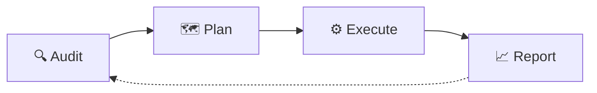

# Hi, I'm Sadaf Liaquat Ali 👋

### SEO • Technical SEO • Shopify & WooCommerce SEO • GA4 • GTM • Server-side Tracking

I help businesses **get found on Google** and **measure what actually brings sales**. 
**5+ years** in SEO, GA4 and GTM for e-commerce stores, local businesses and B2B sites.

 

---

## 📊 At a glance

| 🔎 **5+** | 📈 **15.2K** | 👁️ **249K** | 🗂️ **16** |
|:---:|:---:|:---:|:---:|
| years in SEO, GA4 and GTM | clicks in 6 months (Mattie Nottage) | impressions in 28 days (E Movement) | Search Console results shown |

---

## 🚀 What I do

| Area | What I deliver |
|------|----------------|
| **Technical SEO** | Core Web Vitals, speed, crawling and indexing, structured data, mobile |
| **On-page SEO and content** | Meta tags, headings, keyword mapping, internal links, content briefs |
| **E-commerce SEO** | Shopify and WooCommerce product, collection and category optimization |
| **Local SEO** | Google Business Profile, citations, local pack rankings |
| **Analytics and tracking** | GA4, Google Tag Manager (web and server-side), Meta Conversions API, Consent Mode v2, Google Ads conversion tracking |
| **Reporting** | Looker Studio and BigQuery dashboards in plain language |

### How I work

---

## 📈 Real results (Google Search Console)

| Project | Clicks | Impressions | Period |
|---------|-------:|------------:|--------|
| **Mattie Nottage** (Shopify) | **15.2K** | 91.5K | Aug 2025 to Jan 2026 |
| **E Movement** (e-bikes, UK) | **1.74K** | 249K | 12 Aug to 8 Sep 2026 |
| **Click Tally Counter** (own tool) | **1.65K** | 175K | 20 Jul to 16 Oct 2026 |
| **My Ring Size Calculator** (own tool) | **1.28K** | 62.5K | 20 Apr to 23 Jun 2026 |
| **MHAY Industries** (Shopify) | 738 | 34.5K | Nov 2025 to Jan 2026 |
| **BeeFriends Cleaners** | 521 | 93.2K | Oct to Dec 2025 |
| **The Hybrid Tours** | 390 | 33.5K | Nov 2025 to Jan 2026 |
| **Woking Bikes** (UK) | 310 | 5.29K | From 27 Jul 2026 (3-month view) |

> Full screenshots and more projects: **[View portfolio →](https://sadaf360.github.io/#results)**

  
  

---

## 🛠️ Tools

**Analytics and tracking**

**SEO**

---

## 🎁 Free templates

| Template | What it is |
|----------|------------|
| [**SEO Audit Checklist**](https://github.com/sadaf360/seo-audit-checklist) | Step-by-step technical and on-page audit |
| [**GA4 Setup Checklist**](https://github.com/sadaf360/ga4-setup-checklist) | Proper GA4 property and tracking setup |
| [**Keyword Research Template**](https://github.com/sadaf360/keyword-research-template) | Structured CSV for keyword mapping |
| [**Content Brief Template**](https://github.com/sadaf360/content-brief-template) | Ready-to-use brief for writers |
| [**Schema Markup Snippets**](https://github.com/sadaf360/schema-markup-snippets) | JSON-LD for LocalBusiness, FAQ and Article |

---

## 📬 Let's work together

**Free site review**: send your website and I will tell you the first three things to fix.

- 📧 [sadafshehzadi360@gmail.com](mailto:sadafshehzadi360@gmail.com)
- 📱 Phone / WhatsApp: +92 302 8303210 (Lahore, Pakistan)
- 🌐 [sadaf360.github.io](https://sadaf360.github.io) • 🏢 [sadafseoagency.netlify.app](https://sadafseoagency.netlify.app)

If a template helped you, a ⭐ is always appreciated.

